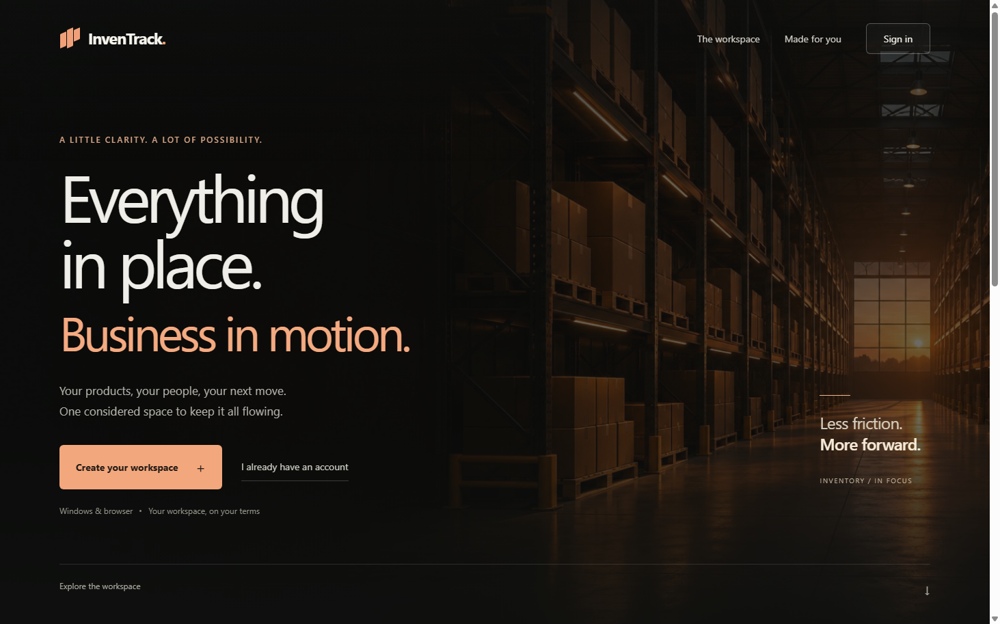

# InvenTrack

**[Open InvenTrack online](https://inventrack-workspace.onrender.com)**

A project by [Shivanshu Gupta](https://github.com/sgshiv001).

InvenTrack is an inventory workspace for small retailers, wholesalers, and distributors. It runs as a Windows application or a Node.js web application. Choose **Online workspace** in the Windows launcher to use the website's accounts and inventory across devices. **Local Windows app** and **Local browser** share a separate workspace on this computer.

Products, suppliers, stock movements, purchase orders, receipts, shipments, accounts, and sessions are stored in SQLite. New workspaces start empty. No sample inventory, fabricated activity, or reset button is included in the operational application.

InvenTrack 3.2.0 adds a connected online desktop mode alongside an animated welcome page, sign-in, and a two-step account setup for retail, wholesale, or operations workspaces. Administrators, wholesalers, and retailers have personalized dashboards. **My account** shows account details and saves a light or dark appearance per user in the current browser.

[](https://inventrack-workspace.onrender.com)

See the [interface screenshots](docs/screenshots/README.md) for sign-in, the inventory dashboard, and personal account settings. Screenshots use disposable verification accounts and inventory.

## Open the web app

[Open InvenTrack online](https://inventrack-workspace.onrender.com). Anyone can visit the welcome page and create a workspace. Sign in to manage your inventory and team accounts.

The app runs on Render's Free service with encrypted database snapshots in managed object storage. An initial visit after inactivity can take about a minute while the service wakes. The website and the Windows **Online workspace** use the same hosted accounts and data. Local records stay on your computer and are not automatically uploaded or merged. See the [hosting instructions](docs/HOSTING.md).

## Download the Windows app

The packaged Windows app includes its runtime; you do not need Node.js to run it.

- [Download the Windows installer (.exe)](https://github.com/sgshiv001/inventrack-inventory-management/releases/download/v3.2.0/InvenTrack-3.2.0-Setup.exe). Install, then open **InvenTrack** from the Start menu.
- [Download the portable Windows app (.zip)](https://github.com/sgshiv001/inventrack-inventory-management/releases/download/v3.2.0/InvenTrack-win32-x64-3.2.0.zip). Extract the entire ZIP, then run `InvenTrack.exe` inside the extracted folder. Keep its support files together.

Both builds are unsigned and offer **Online workspace**, **Local Windows app**, and **Local browser**. The welcome page lets you sign in or create a workspace using your name, email, a password of at least 12 characters, and business type. See the [Windows download instructions](downloads/windows/README.md) and [3.2.0 verification report](reports/RELEASE-3.2.0.md).

## Run or build from source on Windows

Install Node.js 24 and run:

```powershell
npm install
npm run desktop
```

Choose **Online workspace** and sign in with your website account for shared online inventory. Choose **Local Windows app** or **Local browser** for a separate workspace on this computer. The welcome page lets you sign in or create a workspace with your name, email, a password of at least 12 characters, and business type. Workspace owners have administrator access. Existing team members sign in with the account their administrator created. Keep the launcher open in browser mode to run the local server.

To build both Windows distribution formats:

```powershell
npm run desktop:make
```

Electron Forge produces an installer (`Setup.exe`) and a portable ZIP under `out/make/`. These builds are unsigned; Windows may display a publisher warning until a code-signing certificate is configured. Test both builds on a clean Windows account before distributing them.

Release 3.0.2 separates the installer directory (`%LOCALAPPDATA%\inventrack_desktop`) from workspace storage. Do not use earlier installer builds that share the standalone web database directory.

The desktop database is in Electron's per-user `InvenTrack/workspace/inventrack.db` data folder, not inside the application or this repository. The launcher displays its full path and offers **Back up local workspace**. Set `INVENTRACK_DESKTOP_DB` to an explicit database path for a separate workspace. Uninstalling the application does not intentionally delete data. See [LAUNCH.md](LAUNCH.md) for recovery guidance.

## Run the standalone web server from source

For browser mode in the packaged app, choose **Local browser** in the Windows launcher; the source setup below is not required.

Install Node.js 24 and dependencies, then run `npm start` and create your workspace through the welcome page. You can also copy `.env.example` to `.env` and set `ADMIN_EMAIL`, `ADMIN_PASSWORD`, and `ORGANIZATION_NAME` to bootstrap an administrator before the first start. Keep `.env` private.

```powershell
npm install
node --env-file=.env server.js
```

Open `http://localhost:3000`. Authentication is always required. Version 3.0.4 defaults to local-only access (`127.0.0.1`); no online hosting is needed. Keep `HOST=127.0.0.1` in any existing `.env` file. The standalone web server and the Windows launcher use different default database locations; set `DB_PATH` to an explicit path if they should use the same database, and never run two unsupervised copies against it. The Windows launcher itself uses one local server for its two local modes.

## Working features

- Product catalogue with SKU/barcode lookup, CSV import/export, pricing, supplier assignment, and low-stock alerts. CSV exports download committed, organization-scoped database records; Unicode and quoted fields are preserved, and formula-like text cells are neutralized for spreadsheet safety. Desktop exports preserve earlier files with numbered filenames and show the saved path after completion.
- Camera barcode scanning uses the native decoder when supported and a locally bundled ZXing decoder otherwise, including Windows browsers. Camera permission, a working camera, and HTTPS or localhost are required; manual entry and keyboard-style USB scanners remain available.
- Atomic stock movements with an append-only movement ledger, supplier purchase orders, and partial receipts.
- Shipment records and event history, including an interactive WebGL 3D delivery globe based on recorded coordinates and routes. Shipment coordinates must be entered accurately; InvenTrack does not claim live carrier tracking.
- Product cards use neutral initials, not invented product photographs. The optional product-model viewer and upload controls were removed in 3.0.1; the delivery globe remains available.
- Administrator-managed team accounts with admin, wholesaler, and read-only retailer roles, expiring HTTP-only sessions, and organization-scoped records.
- Integrity-checked SQLite backup and restore commands. Legacy model attachments from older releases are preserved during upgrades and backups, although they are no longer viewable or uploadable in the application.

An optional Python 3.10+ reporting tool reads an existing database without changing it: `python tools/inventory_report.py --db <database.db>`. It exports CSV and Markdown summaries from actual records; there is no built-in sample catalogue. Prefer running it against a verified backup. Use `--organization <id>` when the database contains multiple organizations.

## Validation

For the language and technology map, locked dependency setup, and Windows packaging steps, see the [build guide](docs/BUILDING.md).

```powershell
npm test
```

The tests cover database snapshots, empty first-run setup, authentication and role boundaries, inventory writes, stock movements, barcodes, purchase orders, retired-viewer removal, legacy attachment retention, and 3D globe math. The Windows installer and portable ZIP still need hands-on validation on the target machine, including camera permissions and printing/export workflows.

## Important boundaries

Accounts created through the welcome page have separate, organization-scoped workspaces on the local server. Administrators create team accounts within their workspace and assign administrator, wholesaler, or read-only retailer access. Inventory value is an estimate from current quantities and prices. Live carrier integrations, realized-sales accounting, invoices, billing, automatic geocoding, password recovery, and independent point-in-time cloud backups remain outside the current feature set. Review the operational controls in [LAUNCH.md](LAUNCH.md) before a public deployment.

Existing local databases are preserved; removing sample-data seeding does not erase records already stored in them. The repository's old database files remain available in Git history, even though they are no longer tracked in the current version. Review that history if it ever held sensitive data.
