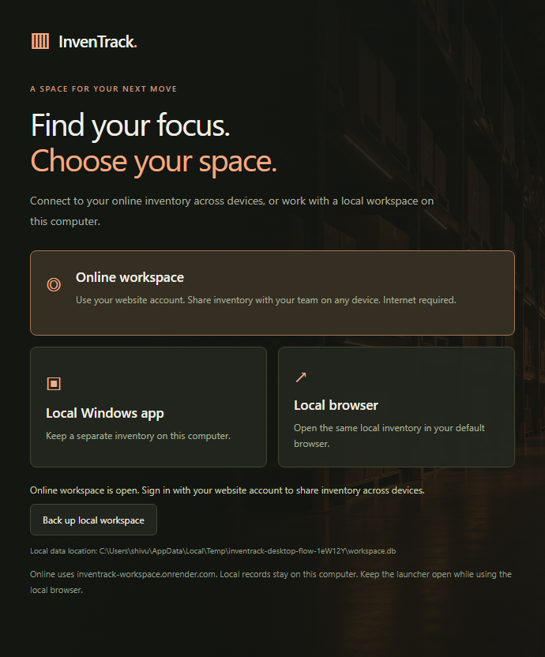
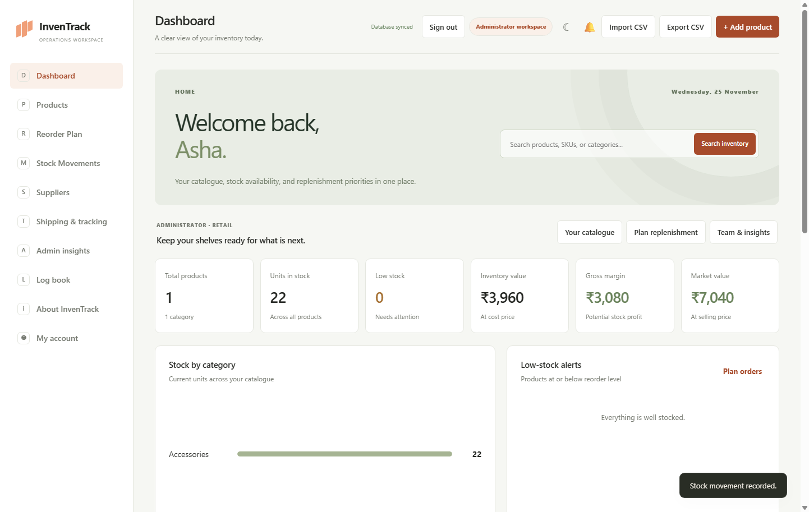
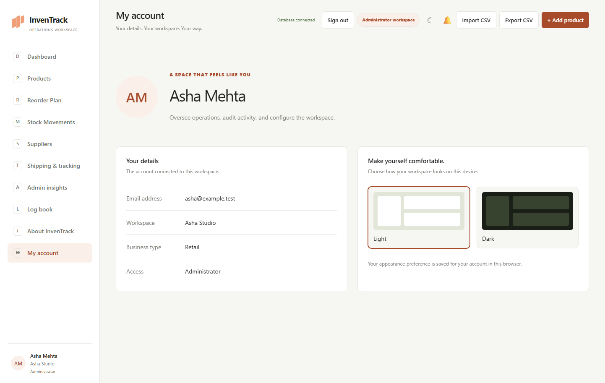

# Interface previews

The online launcher screenshot shows InvenTrack 3.2.0. The welcome, sign-in, dashboard, and account previews show the interface introduced in 3.1.0. Accounts and inventory shown here belong to disposable verification workspaces.

The earlier [dashboard illustration](dashboard.svg) and [shipping illustration](logistics.svg) document the preceding interface.
